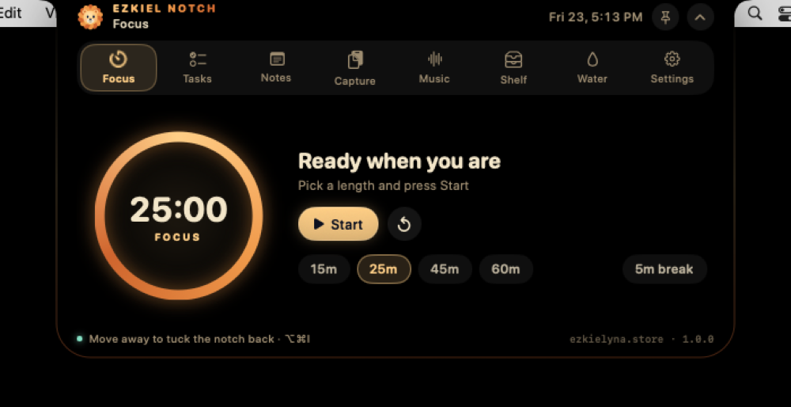
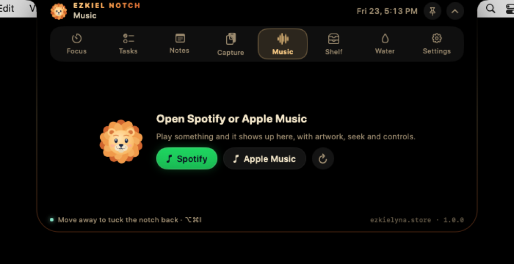
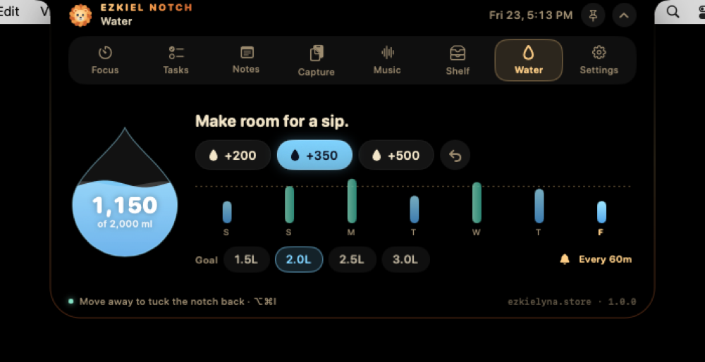
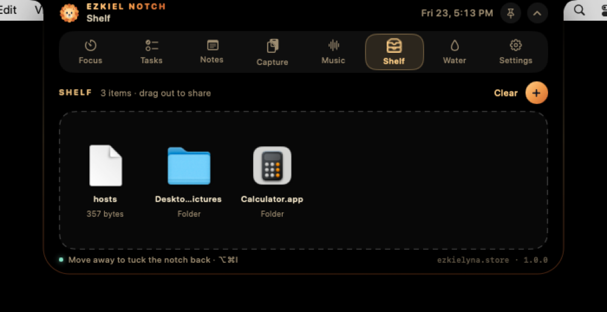
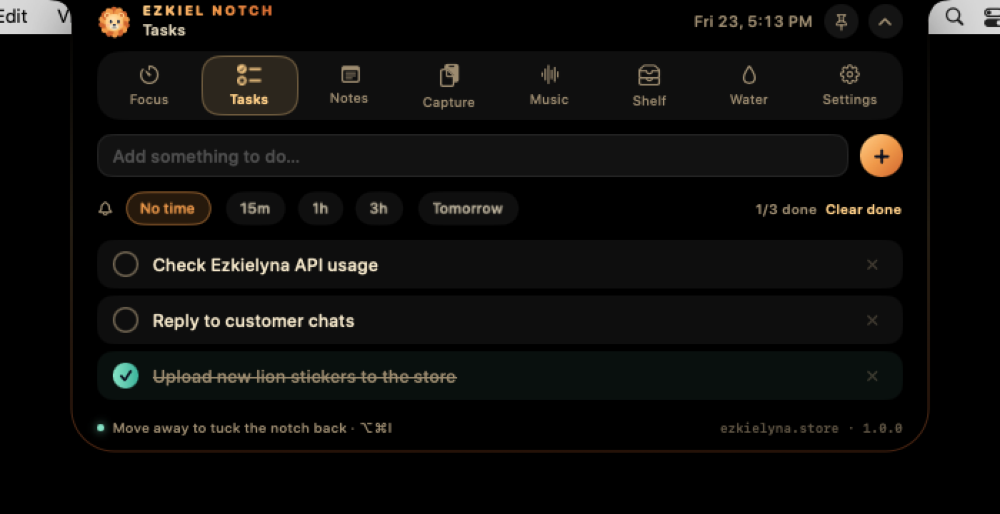
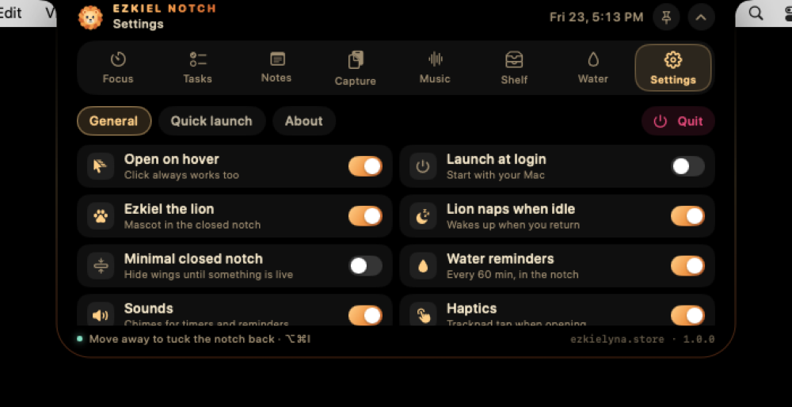

# Ezkiel Notch 🦁

**A living notch for your Mac, made for [ezkielyna.store](https://ezkielyna.store).**
Ezkiel the lion lives in your MacBook's notch: hover (or click) and it opens into a small workspace with Focus, Tasks, Notes, Capture, Music, Shelf, Water and Settings. Native SwiftUI + AppKit, macOS 13+, universal (Apple Silicon + Intel).

<p align="center">
  
  
  
  
  
  
</p>

*Screenshots are taken automatically by CI on a macOS runner (`--self-test --snapshots`).*

> Ezkiel Notch is the successor of IslandDesk 2.1. Opening it quits any running IslandDesk and imports its tasks, notes, clips, shelf and water log automatically.

## Download

Grab the latest **DMG** or **ZIP** from [Releases](https://github.com/cahyohackids/Ezkiel-Notch/releases) (or from the *Actions* tab → latest run → artifact `EzkielNotch-macOS`).

1. Open the DMG and drag **Ezkiel Notch** to **Applications**.
2. The app is ad-hoc signed (not notarized). On first launch: right-click the app → **Open**, or run
   `xattr -cr "/Applications/Ezkiel Notch.app"` once.
3. Music controls ask for permission to control Spotify / Music (System Settings → Privacy & Security → Automation).

## Bahasa Indonesia — cara pakai singkat

- **Arahkan kursor ke notch** → terbuka dengan animasi spring. **Klik** juga bisa. Gerakkan kursor menjauh → notch menutup lagi.
- **⌥⌘I** membuka/menutup notch dari aplikasi mana pun (hotkey global, tanpa izin Accessibility).
- **Pin** (ikon paku) membuat notch tetap terbuka. **Esc** atau tombol ⌃ menutupnya. Klik di luar notch juga menutupnya.
- **Seret file ke notch** → otomatis membuka Shelf; seret file keluar dari Shelf ke chat/email/folder.
- **Klik kanan notch** untuk menu cepat (buka, pin, mode minimal, Quit). Ikon singa di menu bar juga punya menu yang sama.
- Semua data (tugas, catatan, klip, shelf, air minum) disimpan lokal di `~/Library/Application Support/EzkielNotch/data.json`.

## What's inside

| Tab | What it does |
|---|---|
| **Focus** | 15/25/45/60-minute blocks, break mode, pause/resume. Deadline-based, so it stays right across sleep. Countdown shows in the closed notch. Chime + peek when done. |
| **Tasks** | Add with Return, optional reminder (15m, 1h, 3h, tomorrow 9:00). Ezkiel peeks out of the notch when a task is due. |
| **Notes** | Multiple notes with titles, autosaved. |
| **Capture** | Reads the clipboard **only** when you press Capture. Up to 30 clips; copy back with one click. |
| **Music** | Spotify and Apple Music: artwork, title, artist, live progress bar with seeking, previous/play/next. Track changes peek in the closed notch with an equalizer. |
| **Shelf** | Drop files on the notch, drag them out anywhere, Quick Look thumbnails, double-click to open, right-click to reveal/copy path. References only; originals stay in place. |
| **Water** | +200/+350/+500 ml, animated water drop, 7-day chart with goal line, streaks, gentle in-notch reminders during your active hours. |
| **Settings** | Hover behaviour and delay, launch at login, lion mascot & naps, minimal closed notch, sounds, haptics, music source, display picker, quick launch (Ezkielyna, Claude, Finder, Terminal, Downloads, System Settings). |

Plus: battery peeks (plugged in / on battery / low battery), a sleepy lion that naps when you are away and cheers when you come back, and `⌘1…⌘8` to switch tabs while typing.

## Why it no longer "ignores clicks"

IslandDesk 2.1 resized its window every animation frame and to a different height for each tab, and only enabled its content after the resize settled; it also closed while a pop-up menu was open. Ezkiel Notch fixes this at the root:

- The panel has a **fixed frame**; only the SwiftUI notch shape animates, so hit-testing never moves under the cursor.
- The hosting view **accepts the first click** and claims clicks only inside the visible notch; everywhere else the panel ignores the mouse, so the menu bar and windows below keep working.
- The notch never auto-closes while a menu is tracking, the file picker is open, a mouse button is held (dragging a file out) or you are typing.
- No pop-up pickers inside the notch: every choice is an inline chip.
- Apple Events run on a background queue and only target players that are already running.

## Build from source

Requires Xcode 15+ (Swift 5.9+), no third-party dependencies.

```sh
swift test                 # model tests
./scripts/build_app.sh     # dist/Ezkiel Notch.app + DMG + ZIP (universal)
open "dist/Ezkiel Notch.app"
"dist/Ezkiel Notch.app/Contents/MacOS/EzkielNotch" --self-test   # drives the real panel, exit 0 = pass
```

`ARCHS=arm64 ./scripts/build_app.sh` builds Apple Silicon only. CI (`.github/workflows/build.yml`) runs the tests, builds the app, runs the self-test on a macOS runner and uploads the DMG/ZIP; pushing a `v*` tag (or running the workflow with *release* checked) publishes a GitHub Release.

## Layout

```
Sources/NotchCore/        Pure models: data, focus clock, water log, JSON store (unit-tested)
Sources/EzkielNotch/
  App/                    Entry point, AppDelegate, global hotkey, icon renderer, self-test
  Window/                 Fixed-frame NSPanel, click-through hosting view, hover/drag controller
  Model/                  AppModel (single source of truth), types, IslandDesk import
  Design/                 Ezkielyna palette, notch shape, buttons, chips, rings, transitions
  Mascot/                 Ezkiel the lion (vector, animated)
  System/                 Music (Apple Events), battery (IOKit)
  Views/                  Compact, peek, expanded and every tab
```

Design inspired by [Nusa](https://rama2555.github.io/nusa/) (top-attached silhouette with concave ears, spring motion, live activities, peek cards), re-implemented natively for macOS with the Ezkielyna palette: navy `#0B1020`, lion gold `#FFCF87`, orange `#F09A4A`, ember `#D0652E`, teal `#86E3C6`, cream `#F3E6C9`.
