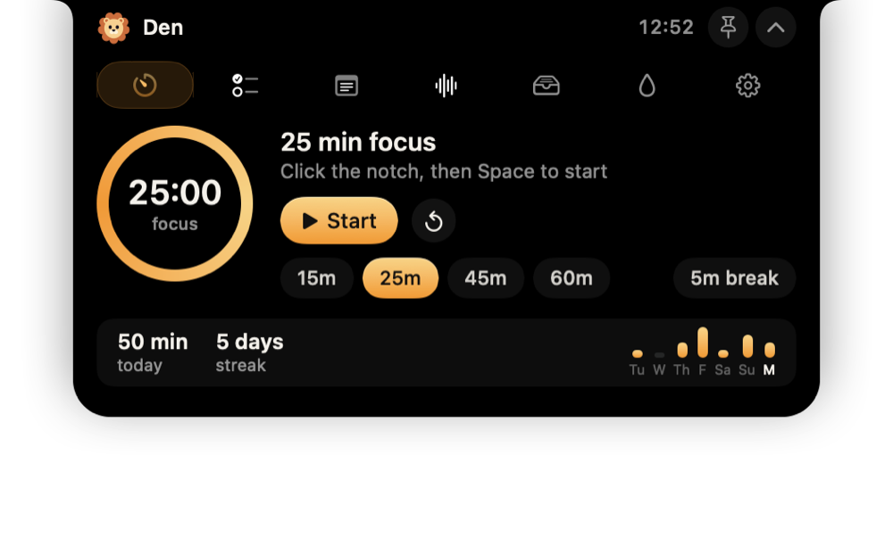
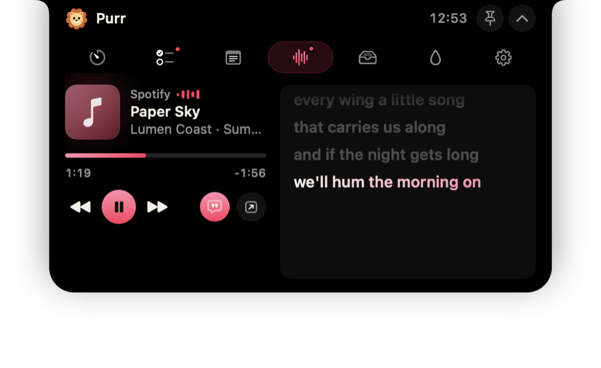
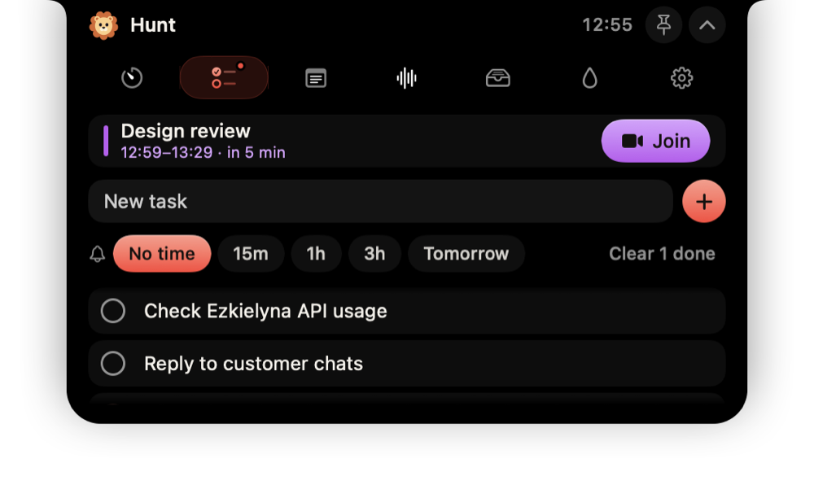
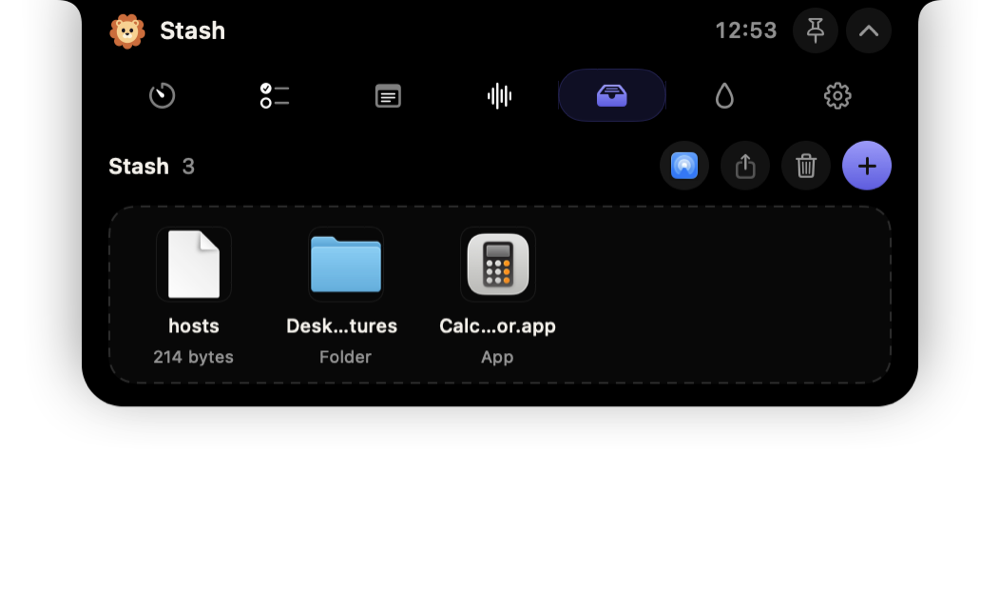
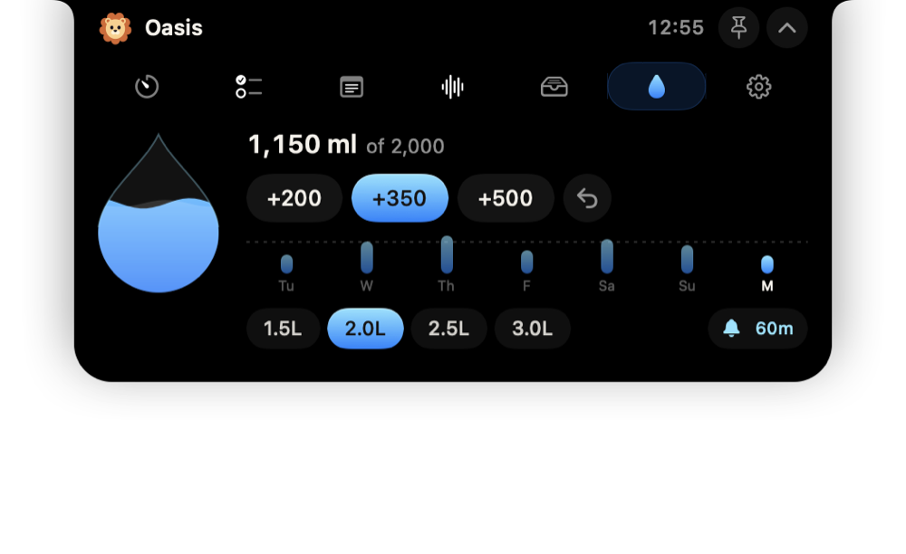
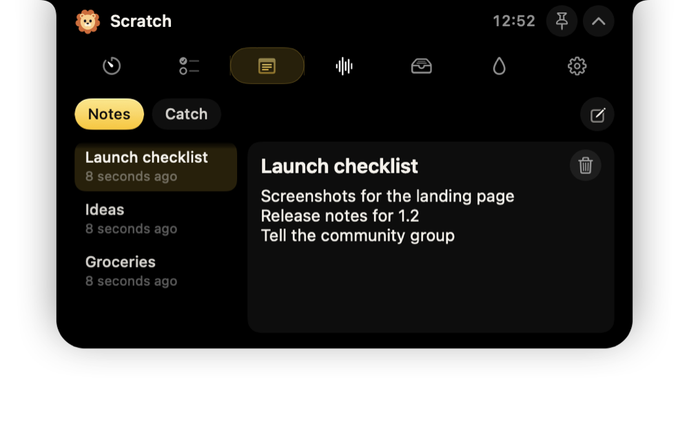

# Ezkiel Notch 🦁

**A living notch for your Mac, made for [ezkielyna.store](https://ezkielyna.store/notch).**
Ezkiel the lion lives in your MacBook's notch. Hover (or click) and it opens into a small workspace where every feature has its own name and colour: **Den, Hunt, Scratch, Purr, Stash, Oasis**, plus small **Whiskers** notifications beside the camera. Native SwiftUI + AppKit, macOS 13+, universal (Apple Silicon + Intel). Free and open source (Apache-2.0).

<p align="center">
  
  
  
  
  
  
</p>

*Screenshots come from the app itself (`--self-test --snapshots <dir> --fake-notch --data <demo.json>`), with demo data.*

## Download

Get the latest **DMG** or **ZIP** from [ezkielyna.store/notch](https://ezkielyna.store/notch) or [Releases](https://github.com/cahyohackids/Ezkiel-Notch/releases).

1. Open the DMG and drag **Ezkiel Notch** to **Applications**.
2. The app is ad-hoc signed (not notarised). On first launch: right-click the app → **Open**, or run
   `xattr -cr "/Applications/Ezkiel Notch.app"` once.
3. macOS asks once for each permission a feature needs: Automation (Purr controls Spotify/Music), Calendar (Rally), Desktop/Downloads (Pounce). Each feature is off until you switch it on, except Purr.

## Bahasa Indonesia — cara pakai singkat

- **Arahkan kursor ke notch** → terbuka. **Klik** juga bisa. Gerakkan kursor menjauh → notch menutup lagi.
- **⌃⌥N** membuka/menutup notch dari aplikasi mana pun (bisa diganti di Settings). Klik notch sekali, lalu **Space** memulai Den, **Esc** menutup, **⌘1…⌘8** pindah tab.
- **Den** = timer fokus + statistik & streak. **Hunt** = tugas + **Rally** (rapat berikutnya, tombol Join). **Scratch** = catatan + **Catch** (klip). **Purr** = musik + **Chorus** (lirik sinkron). **Stash** = rak file + **AirDrop** + **Pounce** (screenshot & unduhan baru). **Oasis** = minum air.
- **Bahasa Indonesia**: Pengaturan › Umum › Bahasa → Indonesia. **Cuaca** di header (ketik kotamu di Pengaturan › Fitur, tanpa izin lokasi), **Prowl** (titik hijau/oranye saat kamera/mikrofon menyala), **Cermin** kamera sebelum rapat, dan pilihan output suara di Purr.
- **Roar** = jumlah pesan belum dibaca dari WhatsApp, Telegram, Teams, Mail, Slack, dan app lain yang punya badge di Dock (cuma angkanya, tanpa izin apa pun, isi pesan tidak dibaca). **Scout** = kabar dari agen AI: Claude Code dan Codex memberi tahu saat selesai atau butuh kamu (sambungkan di Settings › Roar).
- **Whiskers**: volume, Caps Lock, bahasa keyboard, Wi-Fi, AirPods, dan baterai muncul sebentar di samping kamera.
- Hapus sesuatu tanpa sengaja? Tekan **Undo** di pesan yang muncul.
- Semua data disimpan lokal di `~/Library/Application Support/EzkielNotch/data.json`.

## What's inside

| Feature | What it does |
|---|---|
| **Den** | Focus timer: 15/25/45/60-minute blocks, breaks, pause. Wall-clock based and saved, so it survives sleep and restarts. Today's minutes, the streak and the last 7 days. Countdown in the closed notch. |
| **Hunt** | Tasks with reminders (15m, 1h, 3h, tomorrow 9:00). **Rally** puts today's next meeting on top and peeks 5 minutes before with **Join** for Zoom, Meet, Teams and Webex links; "in 5m" counts down in the closed notch. |
| **Scratch** | Notes with titles, saved as you type. **Catch** keeps up to 30 clips you capture from the clipboard (only when you press Capture). |
| **Purr** | Spotify and Apple Music: artwork with a glow in its own colour, seeking, previous/play/next, and a sound-output switcher (AirPods, speakers, display). **Chorus** shows synced lyrics from LRCLIB: lines light up as they're sung, click one to jump; the closed notch sings along. |
| **Roar** | Unread counts from WhatsApp, Telegram, Teams, Mail, Slack and any app with a Dock badge, read from LaunchServices like `lsappinfo` does: only the number, no permission, no message content. A peek with the app's icon when a count goes up (not while that app is in front); click to open the app. Mute any app. |
| **Scout** | AI agents and scripts. **Claude Code** and **Codex CLI** connect from Settings › Roar (a hook in `~/.claude/settings.json` / `notify` in `~/.codex/config.toml`, backed up first). The closed notch shows an agent working or waiting for you; a peek when it finishes or needs you, if you're in another app. AI desktop apps' badges (Claude, ChatGPT, Cursor) show here too. Any script: `open "ezkielnotch://notify?title=Build%20done&body=All%20green"` or `EzkielNotch --notify "title" "body"`. |
| **Weather** | Temperature and sky beside the header (hover for today's range and rain chance). Type your city in Settings › Features; Open-Meteo, no account and no Location permission. Off until you pick a city. |
| **Language** | English or Bahasa Indonesia (Settings › General › Language), or follow macOS. |
| **Prowl** | A green dot while a camera is on and an orange one while a microphone is, beside the lion in the closed notch (public CoreAudio/CoreMediaIO, no permission). |
| **Mirror** | A quick look at yourself before a call, inside the open notch (Hunt, or the menu-bar lion). The camera runs only while it's open; nothing is recorded. |
| **Stash** | Drop files on the notch, drag them out anywhere, **AirDrop** or share them. **Pounce** shows new screenshots and finished downloads with Copy · Stash · Show. |
| **Oasis** | +200/+350/+500 ml, a water drop that fills up, 7-day chart, goal, streak and reminders in your active hours. |
| **Whiskers** | Volume, Caps Lock and keyboard-language overlays (no Accessibility permission; it never sees what you type), Wi-Fi and headphones, battery. |

The open notch is 440pt wide and only as tall as the open feature. Idle, it uses about 0.1% CPU (the lion only animates when its mood changes).

## Why it no longer "ignores clicks"

IslandDesk 2.1 resized its window every animation frame and to a different height for each tab, and only enabled its content after the resize settled; it also closed while a pop-up menu was open. Ezkiel Notch fixes this at the root:

- The panel has a **fixed frame**; only the SwiftUI notch shape animates, so hit-testing never moves under the cursor.
- The hosting view **accepts the first click** and claims clicks only inside the visible notch; everywhere else the panel ignores the mouse, so the menu bar and windows below keep working.
- The notch never auto-closes while a menu is tracking, a mouse button is held (dragging a file out) or you are typing (for up to 20 seconds after the pointer leaves).
- No pop-up pickers inside the notch: every choice is an inline chip.
- Apple Events run on a background queue and only target players that are already running.

## Build from source

Requires Xcode 15+ (Swift 5.9+), no third-party dependencies.

```sh
swift test                 # model tests
./scripts/build_app.sh     # dist/Ezkiel Notch.app + DMG + ZIP (universal)
open "dist/Ezkiel Notch.app"
"dist/Ezkiel Notch.app/Contents/MacOS/EzkielNotch" --self-test   # drives the real panel, exit 0 = pass
```

`ARCHS=arm64 ./scripts/build_app.sh` builds Apple Silicon only. CI (`.github/workflows/build.yml`) runs the tests, builds the app, runs the self-test on a macOS runner and uploads the DMG/ZIP; pushing a `v*` tag (or running the workflow with *release* checked) publishes a GitHub Release.

## Layout

```
Sources/NotchCore/        Pure models: data, focus clock, water log, JSON store (unit-tested)
Sources/EzkielNotch/
  App/                    Entry point, AppDelegate, global hotkey, icon renderer, self-test
  Window/                 Fixed-frame NSPanel, click-through hosting view, hover/drag controller
  Model/                  AppModel (single source of truth), NotchChrome, types
  Design/                 Ezkielyna palette, notch shape, buttons, chips, rings, transitions
  Mascot/                 Ezkiel the lion (vector, animated)
  System/                 Music (Apple Events), lyrics, battery, system events, Pounce, Rally (EventKit), thumbnails
  Views/                  Compact, peek, expanded and every tab
```

Design follows the MacBook notch and the Dynamic Island (a pure-black, top-attached body with concave ears, spring motion, live activities, peek cards), built natively for macOS in SwiftUI and AppKit. Each feature has its own Apple-style two-stop accent: Den amber, Hunt coral, Rally purple, Scratch yellow, Purr pink (or the artwork's colour), Stash indigo, Oasis blue; the app's own accent is lion gold `#FFCF87`.
